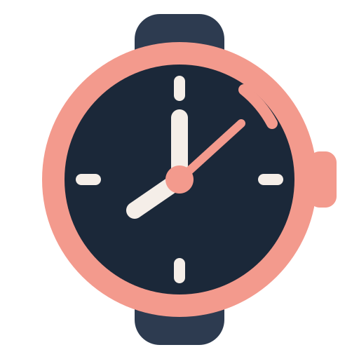

# Watchrate

Native Linux app for measuring mechanical and quartz watch offset and rate against
NTP-synchronized system time. Qt 6 / Wayland, local SQLite storage, Italian UI.

Source repositories: [GitHub](https://github.com/ooonea/watchrate) ·
[Codeberg](https://codeberg.org/ooonea/watchrate).

## Collection

Select a watch in the sidebar. Drag watches to reorder them, use the up/down
buttons, or choose A–Z. The order is stored in SQLite and survives restart.
Add and Edit use a single name/movement dialog; double-click a watch to edit it.
Deletion asks for explicit confirmation with the watch name and sample count,
then removes that watch and its samples in one transaction. Other watches and
their history remain intact. Collection actions are disabled during measurement.
The existing database is migrated by adding an ordering column; sample data and
series are preserved. The selected watch remains selected after reorder/edit.

The detail pane progressively presents Prepare, Stop, and Save. Reading entry
appears after Stop. The watch menu contains new-series, CSV and measurement help.
Closing with an unsaved reading prompts before discarding it.

Select one or more history rows (Ctrl/Shift for multiple selection), then choose
Delete measurement(s). Confirmation precedes an atomic deletion limited to the
selected watch. Graph, latest offset and rate are recalculated afterwards.
Deletion is disabled while armed or while a captured reading is pending.

## Measurement

Choose a watch and arm the measurement. Press Space once, or press Stop, and
remember the time its hands indicated at that instant. The reference freezes.
Enter the watch's local date and time afterwards, then save. Time spent entering
this reading never affects the captured reference. The displayed reference and
its Chrony status remain those of the stop, even if synchronization changes later.

Acquisition occurs on key/button press, not release. Auto-repeat cannot create
additional samples. Escape or Discard cancels the measurement. Loss of application
focus, a detected clock step or suspend cancels an armed measurement; a reference
already captured remains available for entry after focus changes. The watch
selection cannot change until the measurement is saved or discarded. Reading
entry is enabled only after Stop. Stop on a known whole-second landmark to avoid
rounding an arbitrary hand position to the second-resolution input.

Positive offset means the watch is fast. The reference is CLOCK_REALTIME,
disciplined externally by Chrony, not a direct connection to an atomic clock.
Chrony must report a synchronized external reference. Its estimated clock-error
bound is saved with each sample: `abs(system correction) + root dispersion + root delay / 2`.
The UI checks Chrony every five seconds and rejects status
older than fifteen seconds. This is a snapshot, not a certified error bound.
No privileged command or clock adjustment is performed.

Nanosecond timestamp storage and millisecond display are resolution, not accuracy.
Human reaction, keyboard/pointer delivery and event-loop latency are not corrected.
The displayed clock is refreshed for readability; its drawn frame is not the
measurement source. Consistent observation over long intervals reduces the
influence of variable reaction time on rate estimates. It does not calibrate
absolute offset. Mechanical watches benefit from daily readings; quartz watches
usually need longer intervals. The app does not measure acoustic beat rate.

Mean rate uses first and last samples in the current series, with actual elapsed
UTC time, and is shown only for intervals of at least an hour. After setting the
watch, start a new series. Historic samples remain available. The graph covers
the current series; the table and CSV cover all series for the selected watch.
Ambiguous local times during DST transitions should be avoided in this prototype.

## Build and run

`nix build` runs the included tests and creates `result/bin/watchrate`.
`nix run` launches it. The flake pins nixpkgs for reproducible builds. A Chrony daemon must already
synchronize the host clock; the package supplies the monitoring client but does
not configure or adjust the host clock. The app does not modify host configuration.

Without Nix, install Qt 6 Widgets/Sql development files, a C++20 compiler, CMake
and Chrony. Build with `cmake -S . -B build`, then `cmake --build build`.
Run `./build/watchrate`. The Qt SQLite and Wayland plugins must be available.
`cmake --install build --prefix <prefix>` installs the app, desktop entry and icons.

The database is stored beneath Qt's XDG application data directory
(`$XDG_DATA_HOME/ooonea/watchrate/watchrate.sqlite` by default). CSV timestamps
are UTC. The app runs without a background service or listener.

## Backup and restore

The sidebar Archive menu is available even for an empty collection. Backup archive
saves a consistent SQLite snapshot of every watch, its manual order, all series
and measurements. It uses SQLite VACUUM INTO, then an atomic file save with
owner-only read/write permissions. It works while the database is open and can
replace an existing backup after the file dialog's overwrite confirmation.

Restore archive checks a private staged copy for supported Watchrate schema,
integrity and sample references before showing a confirmation with current and
backup watch/sample counts. It replaces the current archive in a single database
transaction; a failed transaction leaves the previous records intact. Save a
backup first if you want to keep the current archive. Legacy archives without
manual ordering are also supported. Invalid files or additional schema objects
are rejected. Backup/restore are disabled during an armed or pending measurement.

These files contain the entire watch collection and its history, not desktop
theme configuration or the application's executable. CSV is separate from a
recoverable archive. Store backups separately from the machine for disk recovery.

## Noctalia / Umbriel

The desktop entry and live Wayland app_id are `dev.ooonea.Watchrate`.
The app uses native Qt widgets, inherited fonts and themed icons, with compositor
decorations. It reads the Noctalia-generated `kdeglobals` color groups and reloads
changed colors without restart. This reuses the existing kcolorscheme template.
An optional `$XDG_CONFIG_HOME/watchrate/theme.ini` overrides these colors;
`data/noctalia-theme.ini.in` is a Noctalia user-template input for that option.
No template or compositor rule is installed by running the app.

An original watch icon is shipped as scalable SVG and 512px PNG, with a bundled
PNG fallback for the application window. Both are covered by the MIT license.
Installing the package into the desktop environment is needed for launcher and
dock desktop-entry lookup; a direct preview alone cannot verify those features.

## Validation

`watchrate --self-test` checks offset signs, midnight arithmetic, clock-step and
suspend detection, Chrony CSV parsing, SQLite insertion, single-key capture, frozen-reference save,
auto-repeat suppression, focus-loss cancellation, known daily rate and RGB-list
theme reload. Collection checks cover legacy migration, selection, persisted
button/drag/alphabetical ordering, blocked deletion during measurement, related
sample deletion, unaffected other-watch history and the final empty state.
History tests cover single and multiple selection/deletion, measurement-state
guards, recalculated graph/rate/empty state, and preservation of other watches.
CTest runs it offscreen against temporary data, never the user's database.
Archive tests cover full round trips, exact row/order/series/precision preservation,
permissions, atomic overwrite, rollback on failed restore, invalid/schema/foreign
key rejection, legacy compatibility and measurement-state guards.
Live Wayland identity, visible layout and owner acceptance are separate checks.

## License

[MIT](LICENSE).
